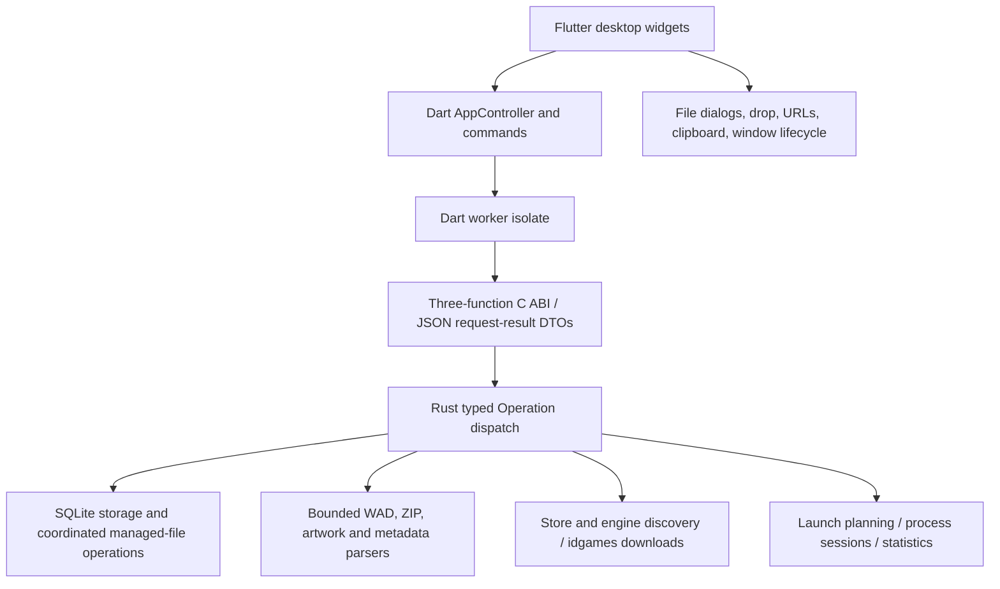

# Architecture

The application uses Flutter 3.47.7 / Dart 3.13.5 and Rust 1.99.0. Flutter builds
the native desktop runner; its CMake or Xcode hook builds and embeds the Rust
library for the same architecture. Linux, Windows and macOS share the Dart UI
and domain core. Flatpak packages the Linux application inside its SDK runtime.

## Responsibilities and modules

`lib/main.dart` owns startup, file-open events, window geometry and shutdown.
`lib/app.dart` owns navigation and shared keyboard/menu actions. The pages in
`lib/ui` own widget state, ID-based selection, filtering and dialog drafts;
cancelling a dialog does not write its draft to storage. `AppController` exposes
database snapshots, pending-operation state and actionable errors through a
ChangeNotifier. The database remains the source of truth; a successful mutation
refreshes its snapshot. Lists and artwork grids build visible items lazily.

`rust/src/api.rs` defines serde-tagged commands and composes the domain services.
It never accepts SQL or widget-level setters. `storage.rs` preserves the legacy
schema and coordinates migrations. `content/` handles formats and bounded
extraction; `discovery.rs` handles store indexing and network operations;
`runtime.rs` plans and owns external game sessions. Native platform differences
are confined to process/discovery adapters and the Flutter runners/plugins.
Rust has no knowledge of widget contexts, layouts or selection.

## Bridge choice and ownership

The production bridge is deliberately small direct Dart FFI:
`dl_abi_version`, `dl_invoke(input_bytes, byte_length)` and `dl_free(result)`.
The complete contract is in [docs/BRIDGE_CONTRACT.md](docs/BRIDGE_CONTRACT.md).
Requests decode into typed Rust `Operation` variants and domain structs. JSON
objects on the Dart side are transport DTOs, not access to arbitrary Rust memory.
This preserves legacy column names at the storage boundary without pointer
graphs, object handles, callbacks or a generated-binding toolchain.

`flutter_rust_bridge` provides generated types and ownership helpers but adds
generator/runtime version coupling. For this coarse request/result API, the
three-function ABI has a smaller maintenance surface. The handwritten boundary
is limited to `ffi.rs` and `lib/bridge/backend.dart`; real bridge tests cover
malformed input, Unicode, concurrent isolates, repeated calls and continued
operation after errors. No performance comparison or native-platform bridge
validation is claimed beyond the checks actually recorded in the audit.

Dart owns the input allocation and frees it in `finally`. Rust borrows those
bytes for the duration of a call, catches panics, and returns one owned UTF-8
JSON result. Dart copies that result and calls `dl_free` exactly once, also in
`finally`. Rust never keeps a Dart pointer. Null/oversized input and ABI mismatch
produce explicit failures. FFI results distinguish success from a stable error
code and readable message. Code must not unwind over the ABI.

Every call runs in a Dart worker isolate. Blocking SQLite, filesystem, parsing
and launch planning therefore stay off the rendering isolate. Long downloads
and game processes use owned Rust workers; the UI polls progress/status.
Downloads have cancellation, concurrency/size/time bounds and cleanup. Closing
the window checks active work, confirms stopping it, awaits shutdown, and stays
open if shutdown fails. Page disposal prevents late widget updates. Library
imports and store scans currently report completion rather than per-file live
progress and cannot be cancelled mid-command; the UI remains responsive.

`lib/state/diagnostics.dart` writes structured operation timing and error codes
to `Logs/application.jsonl` in the library directory, rotating three files at
256 KiB each. The fixed schema excludes request payloads, detailed error messages,
URLs, file paths and launch arguments. Flutter, bridge and core failures share
source tags while the UI retains actionable detail. Logging failure falls back
to concise stderr output and cannot turn a successful operation into an error.

## Persistence and filesystem recovery

Linux retains the original XDG data location. Other platforms use the native
application-support directory, with an explicit absolute data-directory override
for migration and testing. SQLite quick-check and an online backup precede the
first versioned schema transaction. Missing legacy columns are added; unknown
data is retained. WAL, a busy timeout and SQL transactions protect concurrent
requests. A Rust mutex coordinates filesystem mutations that SQLite alone
cannot serialize across worker isolates.

Imports use exclusive file creation, checksum-based duplicate handling and SQL
savepoints. Metadata failure rolls back new records and copied files. Rename
coordinates filesystem rollback with updates to IWAD and remembered load-order
references. Deletion stages managed files in `Trash`, writes recovery metadata,
then commits relational deletion; failure restores staged files. Shared and
external files are preserved. This is coordinated error recovery, not an atomic
filesystem-plus-SQL transaction across power loss. Backups remain necessary.

Legacy nonportable filenames remain readable on their native filesystem; new
imports/rename targets must be portable. Unavailable or foreign-platform paths
remain visible with an error instead of hiding the whole library. Archive paths,
symlinks, decompression sizes, WAD directories and image dimensions are bounded
and validated. Extraction isolates archive and member identities to avoid
basename collisions. Text and artwork never cause shell evaluation.

Session journals record process identity, timestamps, status, logs and derived
statistics. Finished sessions enter SQLite exactly once by session ID; identical
statistics from two distinct runs both count. LastPlayed never moves backwards
when older journals are harvested. Interrupted or corrupt journals remain
visible. Cleanup preserves cached inputs when an interrupted session may still
be using them.

Native sessions own their child process trees: Unix launches use dedicated
process groups; Windows assigns a suspended process to a private Job Object
before resuming it. Stopping a session terminates its owned descendants without
killing unrelated engines. Linux process-tree behavior is tested with real
children; the Windows implementation is cross-compiled and awaits native CI.

## Platform behavior and release gates

Commands use a program and argument vector. Preview formatting is display-only.
Windows engines use executable paths, macOS bundles resolve their declared
executable, and Linux supports PATH, AppImage, Flatpak and Snap launches. Flatpak
uses one typed host boundary with the working directory passed explicitly.
Sibling Flatpak grants cover required data, input and save locations; they do
not grant all of home. Strict Snap engine access depends on its confinement.

Native runners preserve `com.goshapps.DoomLauncher`, icon and CLI identity.
Windows supplies Open With registration, macOS queues Finder file events, and
Linux supplies desktop/AppStream integration. Plugins handle platform file
dialogs, dropped files and external URLs. Real portal, accessibility, DPI and
engine behavior must still be exercised on destination desktops.

CI checks formatting, both stacks, real native bridge calls, Linux desktop
integration, metadata and the complete release artifact matrix. Flatpak builds
inside its SDK from offline staged dependencies. Cross-platform CI configuration
does not establish a successful remote run. See [PLATFORM_SUPPORT.md](PLATFORM_SUPPORT.md)
and the audit for current validation evidence and remaining release gates.
