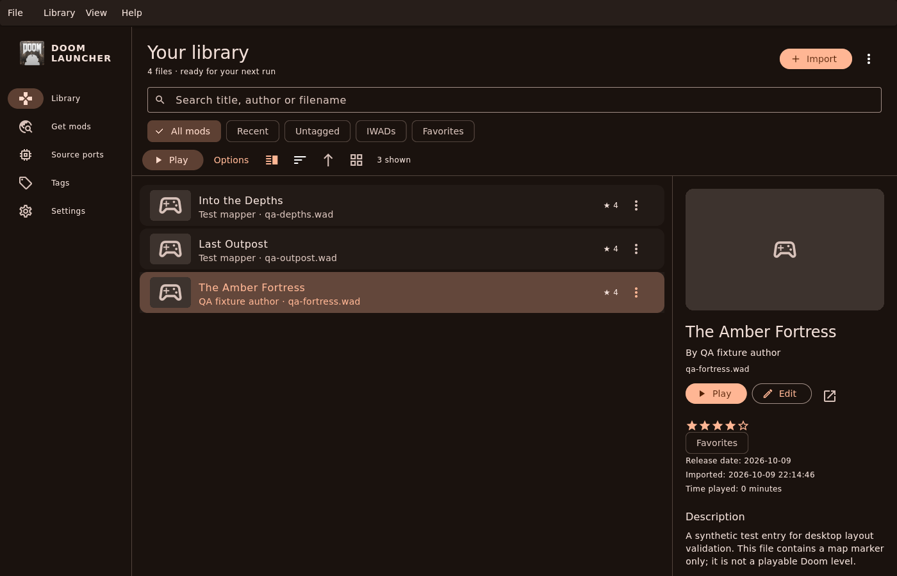

# Doom Launcher

A desktop library and source-port launcher for Doom, Heretic, Hexen and related
games. Version **5.0.0-alpha.1** replaces the Linux Qt interface with Flutter/Dart
and a Rust core, with native build targets for Linux, Windows and macOS.

This migration is a prerelease. The Linux release build, native bridge and desktop
workflows have been exercised; destination-platform installers, desktop portals and
accessibility still require the checks recorded in [PLATFORM_SUPPORT.md](PLATFORM_SUPPORT.md).
Configured CI jobs are not evidence that a release has passed those checks.



See [desktop QA and more screenshots](docs/QA.md) for the tested interactions,
light mode, compact layout and play options. Screenshots use synthetic test data.

## Your library and games

- Import files, folders or dropped files; manage IWADs, mods, tags, ratings,
  comments and metadata. Search, sort and switch between list and artwork views.
- Choose an engine, IWAD, map and skill; arrange additional mods, preview the
  exact launch arguments, remember preferences, load the latest save and
  record or replay demos.
- Track sessions, elapsed play time and supported per-level engine statistics.
  Attach screenshots, saves and demos; inspect associated text and title art.
- Detect source ports and scan Steam, GOG/Heroic and Lutris installations.
  Add native executables, macOS application bundles, or Linux Flatpak/Snap
  engine identifiers manually.
- Search idgames, download with progress and cancellation, import and play.
- Use system, light or dark themes, keyboard shortcuts and resizable desktop
  layouts. Window size, views and launch settings persist between sessions.

Engines and game data are supplied separately. Use your own IWADs or
[Freedoom](https://freedoom.github.io/). Doom 64 rerelease launches its installed
native engine with custom arguments and play-time tracking; its own engine
controls saves and gameplay options. PK7 passes directly to engines that support
it; generic 7z extraction is not implemented. Associated save files can be
opened externally; automatic loading uses the selected engine's latest-save
support. Utility ports are available, while the legacy game-profile tables are
preserved without introducing a separate profile editor.

See [engine compatibility](docs/ENGINE_COMPATIBILITY.md) for save directories,
supported load arguments, statistics and verified engine behavior.

## Existing libraries

Linux retains `$XDG_DATA_HOME/doomlauncher` (normally
`~/.local/share/doomlauncher`), containing `DoomLauncher.sqlite` and `GameFiles`.
The first schema migration checks the database and creates a
`DoomLauncher.pre-flutter-UUID.sqlite` backup. Unknown settings and tables, IDs,
tags, associations and play history are preserved. Windows and macOS use their
platform application-support directories. `DOOMEDLAUNCHER_DATA_DIR` can select
an explicit absolute library directory on any platform.

Before moving a library between computers, close the launcher and copy the
**whole library directory**. External absolute paths still point at their
original locations; unavailable files remain visible for editing and recovery.
New filenames are checked for portability. A same-name import with different
contents is rejected instead of replacing existing content. Removing managed
files places them in the library's `Trash` directory; deleting an external-path
entry leaves its original file intact.

## Build and run

Install Flutter 3.47.7, Rust 1.99.0 and the native dependencies described in
[BUILDING.md](BUILDING.md), then:

```sh
flutter pub get --enforce-lockfile
flutter run -d linux                 # or windows / macos on that operating system
python3 scripts/package.py           # build and package the current native platform
```

Flutter's native build invokes Cargo and bundles the Rust library automatically.
See [BUILDING.md](BUILDING.md) for Flatpak, Windows installers, macOS universal
bundles, offline builds and test commands. The executable supports
`doomedlauncher --help`, `--version` and positional files to import.

## Packages and development

Release automation builds Linux x86_64/aarch64 tarballs and Flatpaks, a Windows
x64 portable ZIP and installer, and a macOS universal ZIP and DMG. Tagged
releases publish only after the complete build/test matrix and checksum gate
pass. Ordinary branch pushes do not publish. Existing downloads at
[GitHub Releases](https://github.com/goshitsarch-eng/DoomedLauncherNix/releases)
may still be the earlier Linux application; no 5.0 release is implied here.

[ARCHITECTURE.md](ARCHITECTURE.md) explains the Dart/Rust boundary and ownership.
[MIGRATION_AUDIT.md](MIGRATION_AUDIT.md) maps the old workflows to their current
implementation and evidence. [CONTRIBUTING.md](CONTRIBUTING.md) describes checks,
and [CHANGELOG.md](CHANGELOG.md) records changes.
[Dependency review](docs/DEPENDENCIES.md) records package choices, licenses,
maintenance considerations and the dependency security checks.

## Credits and license

DoomedLauncherNix is derived from
[Doom Launcher](https://github.com/nstlaurent/DoomLauncher) by
[Hobomaster22 (nstlaurent)](https://github.com/nstlaurent). The launcher concept,
database layout and original Windows application are their work. This fork's
issues belong on [its tracker](https://github.com/goshitsarch-eng/DoomedLauncherNix/issues).

[GPL-3.0-only](LICENSE). Doom Launcher is independent of id Software and ships
no commercial game data.
